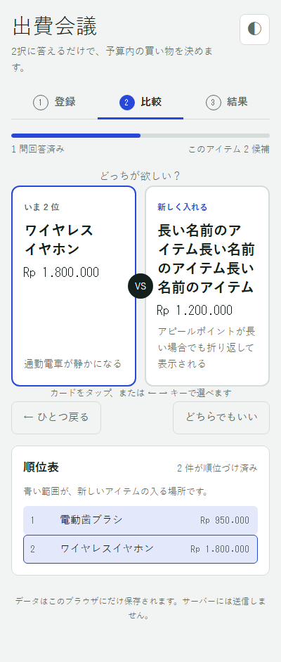
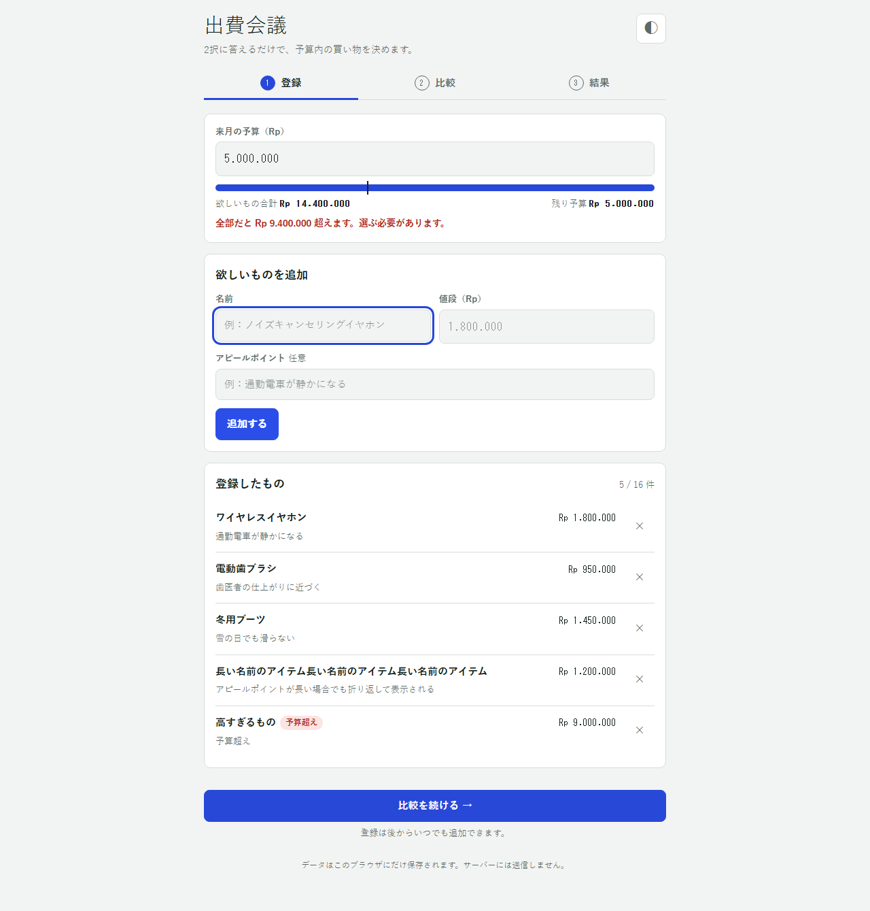

# 出費会議（expense-council）

欲しいものを登録して「どっちが欲しい？」の2択に答えるだけで、予算内で一番合理的な買い物を出すブラウザアプリ。
サーバーもログインもありません。データはブラウザの `localStorage` にだけ保存されます。

公開URL: https://erika-san.github.io/expense-council/




## 使い方（3ステップ）

1. **登録** — 予算（ルピア）と、欲しいものの名前・値段を入れます。候補は最大16件です。
2. **比較** — 2つのうちどちらが欲しいかを選びます。1件ずつ順位表に入れていくので、16件でも最大49問です（`←` `→` キーでも選べます）。
3. **結果** — 順位を点数にして、予算内で合計点が最大になる組み合わせを出します。同点なら支出が少ない方です。

結果画面から「買った」（残り予算から引く）、「やめる」（比較から外す。復活で元の順位に戻る）、「削除」（2回押して確定）ができます。

## ローカルで動かす

ビルドは不要です。静的ファイルなので、どのサーバーでも開けます。

```bash
node test/serve.js        # http://localhost:8080/
```

## テスト

Node 20 以上が必要です。単体テストは追加の準備なしで動きます。

```bash
npm test                  # logic.js の単体テスト（node:test、22件）
```

画面テストは Playwright を使います。

```bash
npm install
npx playwright install chromium
npm run test:ui           # 画面テスト（スマホ幅/PC幅、ライト/ダーク、スクリーンショットは test/screenshots/）
npm run test:all          # 両方
```

## 構成

| ファイル | 役割 |
|---|---|
| `index.html` / `style.css` / `app.js` | 画面・DOM・保存 |
| `logic.js` | 画面に依存しないロジック（順位表への挿入、質問の進行、取り消し、全探索、Rp整形） |
| `test/` | 単体テストと画面テスト |
| `docs/` | 仕様書（目的、PRD、完了の定義、データ設計） |

外部ライブラリは使っていません（Webフォントのみ。読み込めなくても表示は崩れません）。

## ライセンス

[MIT](LICENSE) — Copyright (c) 2026 erika-san
