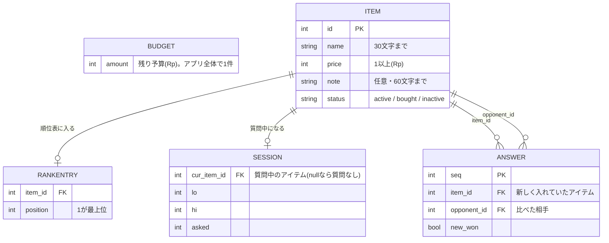

# 出費会議 ER図・データ設計

1件ずつランキングに入れる質問方式と、アイテムの状態（候補・購入済み・やめた）に合わせたデータの形です。

## ER図



順位表（RankEntry）、進行状態（Session）、回答履歴（Answer）は、すべて Item の id を指します。Budget はアプリ全体で1件だけで、Item が bought になるたびに price の分だけ減ります。

## データ辞書

| テーブル | 項目 | 型 | 制約・意味 |
| --- | --- | --- | --- |
| Budget | amount | 整数 または null | 残り予算（Rp）。買うと減り、購入の取り消しで戻る |
| Item | id | 整数 | 連番。主キー |
| Item | name | 文字列 | 必須。30文字まで |
| Item | price | 整数 | 必須。1以上（Rp） |
| Item | note | 文字列 | 任意。60文字まで。アピールポイント |
| Item | status | 列挙 | active（候補）/ bought（購入済み）/ inactive（やめた） |
| RankEntry | item\_id | 整数 | 主キー。Item.id を指す。順位表に入っているアイテム |
| RankEntry | position | 整数 | 1が最上位。重複しない |
| Session | cur\_item\_id | 整数 または null | Item.id を指す。順位表に入っている最中のアイテム。null は質問なし |
| Session | lo | 整数 | 入る位置の候補の下限（0始まり） |
| Session | hi | 整数 | 入る位置の候補の上限（0始まり） |
| Session | asked | 整数 | これまでに答えた質問の数 |
| Answer | seq | 整数 | 主キー。回答の通し番号 |
| Answer | item\_id | 整数 | Item.id を指す。新しく入れていたアイテム |
| Answer | opponent\_id | 整数 | Item.id を指す。比べた相手 |
| Answer | new\_won | 真偽 | item\_id 側を選んだら true。「どちらでもいい」は false |

順位表にも Session にも入っていない active のアイテムは、順番待ちとして扱います。待ち順はランダムです。

## 整合性ルール

- 削除: Item の行を消し、RankEntry と Answer の該当行も消す。Session.cur\_item\_id が削除対象なら null にして次のアイテムへ進む、順位の position は詰め直す。
- 買った: Item.status を bought にし、Budget.amount から price を引く。RankEntry は残す。
- 購入の取り消し: Item.status を active に戻し、Budget.amount に price を戻す。
- やめる・復活: status を切り替えるだけ。RankEntry は残す。やめたアイテムが Session.cur\_item\_id なら、質問から外して次へ進む。
- アイテムの追加: RankEntry にない active のアイテムは順番待ちになり、順位表の active だけを相手に二分探索で入れる。
- 予算の変更: Budget.amount を更新するだけ。予算を超える値段のアイテムは、比較と選定に使わない（status は変えない）。
- ひとつ戻る: Answer の最後の行を取り出し、Session と RankEntry を1問前の状態に戻す。

## 保存形式

localStorage のキー `expense-council-v2` に、次の形のJSONを入れます（実装と一致）。下は「アイテム1を1位に置いたあと、アイテム3を入れている最中。1問答えた直後」の例です。`sample`（サンプル表示中か）、`budgetTouched`（予算を自分で触ったか）、`nextId`（次のアイテムID）は画面の都合で持つ項目です。

```json
{
  "version": 2,
  "sample": false,
  "budget": 5000000,
  "budgetTouched": true,
  "nextId": 4,
  "items": [
    { "id": 1, "name": "ワイヤレスイヤホン", "price": 1800000, "note": "通勤電車が静かになる", "status": "active" },
    { "id": 2, "name": "電動歯ブラシ", "price": 950000, "note": "磨き残しが減る", "status": "active" },
    { "id": 3, "name": "トレッキングシューズ", "price": 1450000, "note": "週末の山歩きに", "status": "active" }
  ],
  "ranking": [1, 2],
  "session": { "cur": 3, "lo": 0, "hi": 1, "asked": 2, "sig": "1,2" },
  "answers": [
    { "item": 2, "opponent": 1, "newWon": false,
      "before": { "ranking": [1], "session": { "cur": 2, "lo": 0, "hi": 1, "asked": 0, "sig": "1" } } },
    { "item": 3, "opponent": 1, "newWon": true,
      "before": { "ranking": [1, 2], "session": { "cur": 3, "lo": 0, "hi": 2, "asked": 1, "sig": "1,2" } } }
  ]
}
```

## 実装メモ（Claude Code向けの補足）

- **取り消し（FR-4）のため、`answers` の各行に `before`（回答前の `ranking` と `session` のスナップショット）を持たせてよい。** 上のERDには載せていないが、「ひとつ戻る」を確実にする最も簡単な方法。
- `session.sig`（比較対象になる順位表アイテムの集合の署名）を持たせ、予算変更・やめる・削除などで集合が変わったら `lo/hi` を引き直す。
- 保存JSONの `version` を 2 にし、将来の形式変更で移行できるようにする。
